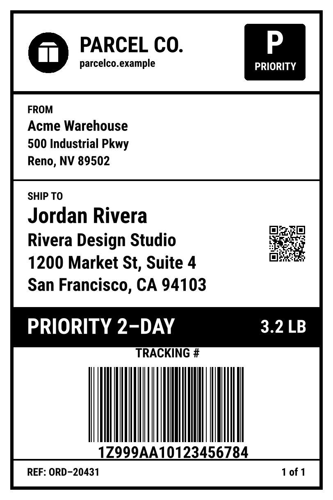

<div align="center">
  
</div>

<div align="center"><strong>react-zpl</strong></div>
<div align="center">Build Zebra printer labels with React.<br />Components, flexbox and Tailwind classes that compile to ZPL.</div>
<br />
<div align="center">
<a href="https://github.com/caddy-industries/react-zpl/actions/workflows/ci.yml"></a>
<a href="https://www.npmjs.com/package/@caddy-industries/react-zpl"></a>
</div>
<br />
<div align="center">
<a href="https://caddy-industries.github.io/react-zpl/">Docs</a>
<span> · </span>
<a href="https://caddy-industries.github.io/react-zpl/components/">Components</a>
<span> · </span>
<a href="packages/react-zpl">Package</a>
<span> · </span>
<a href="packages/cli">CLI</a>
</div>

## Introduction

A set of React components for building thermal printer labels, plus a renderer
that turns them into ZPL, the language Zebra and most other label printers speak.
It works like react-email, but for labels.

## Why

Writing ZPL by hand means placing every field at exact dot positions, then
reprinting to see whether it fits. A new label size or printer resolution means
doing it all again.

With react-zpl you lay labels out with flexbox and Tailwind classes, pass in
data as props, and preview the result locally before anything is printed. The
same component prints at 203, 300 or 600 dpi and on any stock size.

## Install

```sh
npm install @caddy-industries/react-zpl
npm install -D @caddy-industries/react-zpl-cli
```

## Getting started

```tsx
import { Barcode, Box, Label, Text, render } from '@caddy-industries/react-zpl';

function ShippingLabel({ name, tracking }: { name: string; tracking: string }) {
  return (
    <Label width="4in" height="6in" className="p-4 gap-3">
      <Text className="text-xs uppercase">Ship to</Text>
      <Text className="text-3xl">{name}</Text>
      <Box className="flex-1 items-center justify-center">
        <Barcode value={tracking} height="1in" />
      </Box>
    </Label>
  );
}

const zpl = await render(<ShippingLabel name="Jordan Rivera" tracking="1Z999AA10123456784" />);
// ^XA^PW812^LL1218 ... ^XZ — send it to the printer on port 9100
```

Preview your labels with live reload:

```sh
npx react-zpl dev
```

## Components

| Component | What it draws |
| --- | --- |
| `<Label>` | The label itself: size, resolution, printer margin |
| `<Box>` | Flexbox rows and columns, borders, rounded corners, black fill |
| `<Text>` | Printer font 0 at any size, wrapped, rotated or white on black |
| `<Barcode>` | Code 128, Code 39, EAN-13, UPC-A, Data Matrix, PDF417 |
| `<QRCode>` | QR codes with a chosen error correction level |
| `<Image>` | PNG images, converted to 1-bit graphics |
| `<Line>` / `<Divider>` | Horizontal and vertical rules |

See the [component catalog](https://caddy-industries.github.io/react-zpl/components/) for 44 examples at common stock sizes.

## Support

react-zpl writes standard ZPL II, so it works with Zebra desktop, industrial and
mobile printers and other printers that understand ZPL.

| Resolution | Stock sizes | Output |
| --- | --- | --- |
| 152, 203, 300, 600 dpi | Any size in `in`, `mm`, `px` or dots | ZPL string, SVG preview |

## Development

```sh
pnpm install
pnpm build
pnpm test
pnpm --filter example-shipping-label dev   # preview the example labels
pnpm docs:build                            # build the docs website to apps/docs/dist
```

| Folder | What's in it |
| --- | --- |
| [`packages/react-zpl`](packages/react-zpl) | Components, layout, Tailwind classes, ZPL output and preview |
| [`packages/cli`](packages/cli) | `react-zpl dev` and `react-zpl export` |
| [`apps/docs`](apps/docs) | Docs site and component catalog |
| [`examples/shipping-label`](examples/shipping-label) | Shipping label, product tag and bin label |

## License

[MIT](LICENSE) © Caddy Industries
